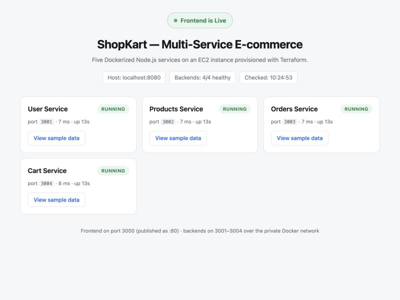

# ShopKart — Multi-Service Node.js E-commerce on AWS with Terraform and Docker

Five Dockerized Node.js services (four backends + one frontend) deployed to an
AWS EC2 instance inside a Terraform-provisioned VPC. Docker is installed and all
five containers are started by the instance's user-data script, so the whole
environment is reproducible with a single `terraform apply`.

---

## 1. Architecture

```
                        Internet
                            │
                   :80 / :3000 (public)
                            │
┌───────────────────────────┼─────────────────────────────────────────┐
│ VPC  10.20.0.0/16         │                                         │
│                           │                                         │
│  ┌── Public subnet 10.20.1.0/24 ──────────────────────────────────┐ │
│  │                        │                                       │ │
│  │   ┌── EC2  t3.micro · Ubuntu 22.04 ──────────────────────────┐ │ │
│  │   │                    │                                     │ │ │
│  │   │   ┌────────────────▼─────────────┐                       │ │ │
│  │   │   │ frontend          :3000      │  published as :80     │ │ │
│  │   │   └───────┬──────────────────────┘                       │ │ │
│  │   │           │ docker network "shopkart-net"                │ │ │
│  │   │   ┌───────┴────┬────────────┬────────────┐               │ │ │
│  │   │   ▼            ▼            ▼            ▼               │ │ │
│  │   │ user:3001  products:3002  orders:3003  cart:3004         │ │ │
│  │   └──────────────────────────────────────────────────────────┘ │ │
│  └────────────────────────────────────────────────────────────────┘ │
│   Internet Gateway · public route table · security group            │
└─────────────────────────────────────────────────────────────────────┘
```

The frontend reaches each backend by container name over the private Docker
bridge network (`http://user-service:3001`, etc.), so backend ports are never
exposed to the internet — the security group only allows 3001–3004 from inside
the group itself.

### Services

| Service            | Container port | Sample response            | Endpoints                         |
| ------------------ | -------------- | -------------------------- | --------------------------------- |
| `user-service`     | 3001           | `user Service Running`     | `/`, `/health`, `/users`          |
| `products-service` | 3002           | `products Service Running` | `/`, `/health`, `/products`       |
| `orders-service`   | 3003           | `orders Service Running`   | `/`, `/health`, `/orders`         |
| `cart-service`     | 3004           | `cart Service Running`     | `/`, `/health`, `/cart`           |
| `frontend`         | 3000 (→ 80)    | `Frontend is Live` page    | `/`, `/health`, `/api/status`, `/api/{service}` |

`GET /api/status` on the frontend returns the live health of all four backends
in one JSON document — the quickest way to prove the whole stack is up.

### Repository layout

```
.
├── docker-compose.yml          # local build-and-test harness
├── docs/                       # captured evidence (screenshot, status JSON)
├── scripts/
│   ├── build-and-test.sh       # build all 5 images, run them, assert endpoints
│   └── push-images.sh          # tag and push all 5 images to Docker Hub
├── services/
│   ├── user-service/           # server.js, package.json, Dockerfile
│   ├── products-service/
│   ├── orders-service/
│   ├── cart-service/
│   └── frontend/               # + public/index.html
└── terraform/
    ├── versions.tf             # required_version + AWS provider ~> 5.60
    ├── provider.tf             # region + default tags
    ├── variables.tf            # all inputs, documented
    ├── network.tf              # VPC, IGW, public subnet, route table
    ├── security.tf             # security group and its rules
    ├── ec2.tf                  # Ubuntu AMI lookup + instance + user-data
    ├── user_data.sh.tftpl      # Docker install, image pull, container run
    ├── outputs.tf              # public IP / DNS / URLs
    └── terraform.tfvars.example
```

---

## 2. Prerequisites

- Docker Desktop (or Docker Engine) running locally
- A Docker Hub account
- Terraform ≥ 1.5
- AWS credentials with permission to create VPC and EC2 resources

---

## 3. Build and test the images locally

```bash
DOCKERHUB_USERNAME=<your-dockerhub-username> ./scripts/build-and-test.sh
```

The script builds all five images, starts them with Docker Compose and asserts
every endpoint. Expected output:

```
==> Endpoint checks
OK      user-service       http://localhost:3001/
OK      products-service   http://localhost:3002/
OK      orders-service     http://localhost:3003/
OK      cart-service       http://localhost:3004/
OK      frontend page      http://localhost:8080/
OK      aggregated state   http://localhost:8080/api/status
```

The frontend is on <http://localhost:8080> locally (port 80 is reserved for the
EC2 deployment). Tear the local stack down with `docker compose down`.



---

## 4. Push the images to Docker Hub

```bash
docker login
DOCKERHUB_USERNAME=<your-dockerhub-username> ./scripts/push-images.sh
```

The script builds each image with `docker buildx` for both `linux/amd64` and
`linux/arm64`, then pushes ten tags — `:1.0.0` and `:latest` for each of the
five services:

```
<username>/shopkart-user-service:1.0.0
<username>/shopkart-products-service:1.0.0
<username>/shopkart-orders-service:1.0.0
<username>/shopkart-cart-service:1.0.0
<username>/shopkart-frontend:1.0.0
```

Keep the repositories **public** so the EC2 instance can pull them without
credentials. If they must be private, set `dockerhub_token` in
`terraform.tfvars` — but note that user-data is readable through the instance
metadata service, so a short-lived access token is the safer choice.

---

## 5. Deploy with Terraform

```bash
cd terraform
cp terraform.tfvars.example terraform.tfvars
# edit terraform.tfvars and set dockerhub_username

terraform init
terraform fmt -check
terraform validate
terraform plan
terraform apply
```

### What gets created

| Resource                                | Purpose                                          |
| --------------------------------------- | ------------------------------------------------ |
| `aws_vpc.main`                          | VPC `10.20.0.0/16`, DNS support + hostnames on    |
| `aws_internet_gateway.main`             | Internet access for the public subnet             |
| `aws_subnet.public`                     | `10.20.1.0/24`, auto-assigns public IPs           |
| `aws_route_table.public` + association  | `0.0.0.0/0` → internet gateway                    |
| `aws_security_group.app`                | Frontend + internal service rules                 |
| `aws_instance.app`                      | Ubuntu 22.04, t3.micro, encrypted gp3 root, IMDSv2 |

### Security group rules

| Direction | Port(s)   | Source                      | Why                                   |
| --------- | --------- | --------------------------- | ------------------------------------- |
| Ingress   | 80        | `var.allowed_http_cidr`     | Public access to the frontend         |
| Ingress   | 3000      | `var.allowed_http_cidr`     | Frontend on its native port           |
| Ingress   | 3001–3004 | the security group itself   | Internal service-to-service traffic   |
| Ingress   | 22        | `var.allowed_ssh_cidr`      | Optional — no rule unless you set it  |
| Egress    | all       | `0.0.0.0/0`                 | apt + Docker Hub pulls                |

### Input variables

| Variable             | Default        | Notes                                        |
| -------------------- | -------------- | -------------------------------------------- |
| `dockerhub_username` | *(required)*   | Account that hosts the five images           |
| `aws_region`         | `ap-south-1`   |                                              |
| `instance_type`      | `t3.micro`     |                                              |
| `image_tag`          | `1.0.0`        |                                              |
| `vpc_cidr`           | `10.20.0.0/16` |                                              |
| `public_subnet_cidr` | `10.20.1.0/24` |                                              |
| `allowed_http_cidr`  | `0.0.0.0/0`    | Narrow to your own IP for a real deployment  |
| `allowed_ssh_cidr`   | `null`         | No SSH rule is created while this is null    |
| `key_pair_name`      | `null`         | Existing EC2 key pair, for SSH               |
| `dockerhub_token`    | `null`         | Only for private repositories                |
| `frontend_host_port` | `80`           | 3000 is always published as well             |
| `root_volume_size`   | `16`           | GiB                                          |

### What user-data does on boot

1. Waits for cloud-init's apt locks to clear, then installs Docker Engine from
   Docker's official apt repository (with GPG key and signed source list).
2. Enables the Docker service and adds `ubuntu` to the `docker` group.
3. Optionally logs in to Docker Hub (only when `dockerhub_token` is set).
4. Creates the `shopkart-net` bridge network.
5. Pulls all five images.
6. Runs the four backends on 3001–3004 with `--restart unless-stopped`.
7. Runs the frontend, published on port 80 and 3000, with the backend URLs
   injected as environment variables.
8. Runs a smoke test against all five `/health` endpoints and writes the result
   to `/home/ubuntu/deployment-status.txt`.

Full progress log on the instance: `/var/log/shopkart-deploy.log`.

---

## 6. Verify the deployment

`terraform apply` prints the access details:

```
Outputs:

frontend_url            = "http://<public-ip>"
frontend_url_port_3000  = "http://<public-ip>:3000"
instance_public_ip      = "<public-ip>"
instance_public_dns     = "ec2-<public-ip>.<region>.compute.amazonaws.com"
instance_id             = "i-0123456789abcdef0"
vpc_id                  = "vpc-0123456789abcdef0"
public_subnet_id        = "subnet-0123456789abcdef0"
security_group_id       = "sg-0123456789abcdef0"
health_endpoints        = {
  "all_services"    = "http://<public-ip>/api/status"
  "frontend_health" = "http://<public-ip>/health"
}
ssh_command             = "ssh -i ~/.ssh/<key>.pem ubuntu@<public-ip>"
verify_backends_command = "ssh ubuntu@<public-ip> 'cat deployment-status.txt && docker ps'"
```

Give the instance 2–3 minutes after `apply` returns — user-data is still
installing Docker and pulling images. Then:

```bash
# Frontend homepage ("Frontend is Live")
curl "$(terraform output -raw frontend_url)"

# All four backends in one call
curl "$(terraform output -raw instance_public_ip)/api/status"

# Sample data proxied from each backend
curl "$(terraform output -raw instance_public_ip)/api/products"
```

A healthy `/api/status` reports `"healthy": 4, "total": 4`. Open
`frontend_url` in a browser for the status dashboard.

With SSH enabled you can inspect the containers directly:

```bash
ssh ubuntu@<public-ip> 'cat deployment-status.txt'
ssh ubuntu@<public-ip> 'docker ps'
ssh ubuntu@<public-ip> 'docker logs user-service'
ssh ubuntu@<public-ip> 'sudo tail -f /var/log/shopkart-deploy.log'
```

---

## 7. Tear down

```bash
cd terraform
terraform destroy
```

Everything is inside the dedicated VPC, so `destroy` leaves no stray resources.

---

## 8. Troubleshooting

| Symptom                                 | Cause and fix                                                                                   |
| --------------------------------------- | ----------------------------------------------------------------------------------------------- |
| Frontend not reachable right after apply | User-data is still running. Wait 2–3 minutes; check `/var/log/shopkart-deploy.log`.              |
| `/api/status` shows a backend down      | `docker ps -a` and `docker logs <name>` on the instance. Usually a bad image tag.                 |
| `pull access denied`                    | Repositories are private — make them public or set `dockerhub_token`.                             |
| Containers never start                  | Confirm the images exist for `linux/amd64`; on an Apple Silicon Mac build with `--platform linux/amd64`. |
| `terraform apply` fails on the AMI       | The AMI filter targets `amd64`; keep an x86_64 instance type (t3/t2), not Graviton.              |

> **Apple Silicon note:** a plain `docker build` on an M-series Mac produces
> `arm64`-only images, which a t3.micro cannot run. `scripts/push-images.sh`
> handles this by building with `docker buildx` for
> `linux/amd64,linux/arm64`, so the pushed images work on both Intel and
> Graviton instances. Override with `PLATFORMS=linux/amd64` if you only need
> x86_64.

---

## 9. Security and cost notes

- Backend ports 3001–3004 are reachable only from inside the security group;
  only 80 and 3000 are public.
- No SSH rule is created unless `allowed_ssh_cidr` is set explicitly.
- IMDSv2 is required on the instance and the root volume is encrypted.
- `allowed_http_cidr` defaults to `0.0.0.0/0` for the demo — narrow it to your
  own IP for anything real.
- A t3.micro with a 16 GiB gp3 volume is a few US dollars per month; run
  `terraform destroy` when you are finished.

---

## 10. Mapping to the evaluation criteria

| Criterion                                        | Marks | Where it is implemented                                                        |
| ------------------------------------------------ | ----- | ------------------------------------------------------------------------------ |
| VPC, subnet and security group setup             | 10    | `terraform/network.tf`, `terraform/security.tf`                                 |
| EC2 provisioning with Docker setup                | 10    | `terraform/ec2.tf`, steps 1–2 of `terraform/user_data.sh.tftpl`                 |
| Container deployment via user-data               | 10    | Steps 3–7 of `terraform/user_data.sh.tftpl`                                     |
| Public access to the frontend                    | 10    | SG rules for 80/3000, `services/frontend`, `frontend_url` output                |
| Documentation                                     | 10    | This README plus inline comments in every file                                  |
